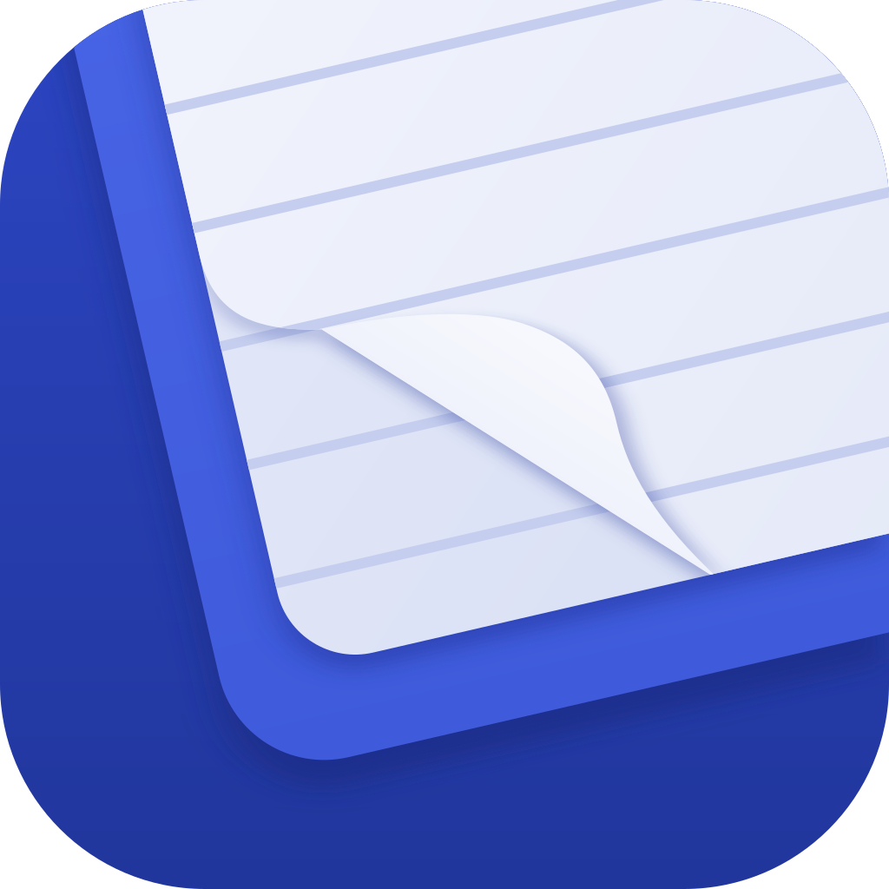

<div align="center">



# Relay

**All your Gmail and Microsoft inboxes, in one fast Windows app.**


</div>

> [!NOTE]
> **This is a personal project.** I built Relay for my own use and share the code so people can look
> at it. It isn't a product: there's no support and no promise it will work for you. See
> [Personal use](#personal-use) below.

---

## Why Relay

I have a personal Gmail, a work account and a school account, and checking three web inboxes got
old. Relay puts them in one list. It stays fast because everything runs locally: a small Rust
backend syncs your mail into a cache on your PC, and the interface only reads from that cache, so
it's instant and still works offline.

## Features

|  |  |
| --- | --- |
| 📥 **One inbox** | Gmail, Outlook.com, and Microsoft work and school accounts in one list, newest first, with a color for each account. |
| 🗂️ **Your way of sorting** | View everything at once, a group (Personal, Work, School), or one account's Inbox, Archived, Deleted and Spam. |
| ⚡ **Keyboard first** | `j` / `k` to move, `e` archive, `r` reply, a <kbd>Ctrl</kbd> <kbd>K</kbd> command bar, and every shortcut can be changed in Settings. |
| 🔒 **Private by design** | Your mail goes straight between your PC and Google or Microsoft. Emails open in a locked-down view (no scripts, remote images off until you allow them), and sign-ins are encrypted with Windows' own data protection. |
| ✉️ **Everything syncs back** | Read, star or flag, archive, delete, reply, reply all, forward and send, all from the right account. |
| 🎨 **Make it yours** | Light, dark or match Windows, a choice of accent color and font. |
| 🔄 **Updates itself** | Relay checks for new versions and installs them when you say so (Settings → Updates). |

## Built with

- **[Tauri 2](https://tauri.app):** a small native Windows app using the system WebView2. Rust does all the networking and storage.
- **React + TypeScript** with Vite, styled with **[Tailwind CSS v4](https://tailwindcss.com)** and **[shadcn/ui](https://ui.shadcn.com)** components.
- **SQLite** for the local mail cache, **OAuth 2.0 + PKCE** for sign-in, and the **Gmail API** and **Microsoft Graph** for mail.

## Running it yourself

You need Windows 11, [Node.js](https://nodejs.org) 20 or newer, [Rust](https://rustup.rs) (stable, MSVC)
and the Visual Studio C++ Build Tools.

```bash
npm install
npm run app        # launch the desktop app (the UI reloads as you edit)
npm run dev        # the UI alone in a browser, with sample data
```

Relay signs in through **your own** Google and Microsoft app registrations; none are included
here. **[docs/SETUP.md](docs/SETUP.md)** walks through creating them and pasting their IDs into
Settings → Connections.

<details>
<summary><b>Building the installer and releasing updates</b></summary>

<br />

`npm run package` builds a Windows installer in `src-tauri/target/release/bundle/nsis/`. Installs
and updates are signed with a private key kept outside the repo at `~/.tauri/relay.key`. Keep a
backup: without it, installed copies can't be updated.

To release a new version, raise the version number and push the tag it creates:

```bash
npm version patch          # or minor / major; commits and tags, e.g. v0.1.1
git push --follow-tags     # GitHub Actions builds, signs and publishes the release
```

Installed copies find the new version on their next check.

</details>

<details>
<summary><b>Project layout</b></summary>

<br />

```
src/                     React UI
  App.tsx                app state, actions and layout
  components/            sidebar, mail list, reader, compose, settings, command bar
    ui/                  shadcn/ui components
  api.ts                 typed calls into the Rust backend
  updater.ts             version check, download and install
  mock.ts                sample data for `npm run dev`
src-tauri/src/           Rust backend
  commands.rs            commands the UI calls
  oauth.rs               browser sign-in (loopback + PKCE), token refresh
  gmail.rs / graph.rs    Gmail API and Microsoft Graph clients
  sync.rs                background sync
  db.rs                  SQLite cache
  crypt.rs               encryption for saved sign-ins (Windows DPAPI)
  mime.rs                building and parsing messages
```

</details>

## Not there yet

- Sent and Drafts folders, conversation threading and attachments on outgoing mail
- Search covers the mail Relay has downloaded (the newest 100 per account by default)
- New mail is checked every couple of minutes rather than pushed instantly
- No desktop notifications yet

## Personal use

Relay is a personal, non-commercial project. The code is public so it can be read; it isn't
offered for reuse, and there's no license attached, so the usual "all rights reserved" applies.

- **Fonts:** Relay bundles only [Geist](https://vercel.com/font) (SIL Open Font License). The
  *SF Pro* options in Settings are used only if those fonts are already installed on your PC;
  no Apple fonts are included in this repository or the app.
- **Trademarks:** Gmail and Google are trademarks of Google LLC, and Outlook and Microsoft are
  trademarks of Microsoft Corporation. Relay isn't affiliated with or endorsed by either.
